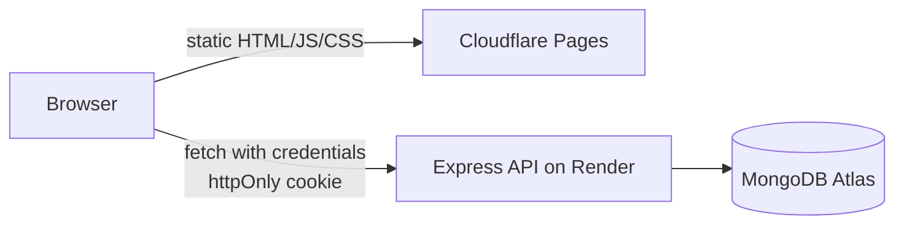

# Doctor Tracker – Frontend

**Elevator pitch:** Doctor Tracker is a modern, responsive admin portal for managing doctors and their patients. Admins sign in securely, see live analytics on a dashboard, and manage doctors and patients with fast search, filters and pagination. This repository is the Next.js client; it talks to a separate Express API over REST.

## Live demo

| | |
|---|---|
| **Login page** | https://doctortracker.bizvely.com/admin-login |
| API health check | https://doctortracker-api.bizvely.com/health |
| Backend repository | https://github.com/Bizvely/doctor-tracker-backend |

### Demo login

| | |
|---|---|
| Email | `demo@doctortracker.com` |
| Password | `IHRhgs976#@$` |

> **⏳ Please read before you sign in:** the API runs on a **free hosting plan** (Render) that goes to sleep when nobody uses it. The **first request after a quiet period can take up to about 40–50 seconds** (sometimes close to a minute) while the server wakes up. The app shows a "Waking up the server…" message during this time. It is not broken: please wait, and after that everything is fast. An UptimeRobot monitor pings the API every 5 minutes to reduce these waits, but the free plan can still sleep or restart, so the delay can still happen.

Notes for reviewers:

- The demo account has full access, so you can create, edit and delete doctors and patients. Its password cannot be changed.
- If the dashboard is empty, click **Load demo data** (or use **Settings → Demo data**) to fill it with sample doctors and patients. Turning it off removes only the sample records, never the ones you added.
- Please do not enter real personal or medical information.

## Features

- Secure admin login, protected routes, logout, automatic redirect when the session expires
- **Dashboard:** total doctors and patients, visits today / 7 / 30 / 90 days with comparison to the previous period, visits-over-time area chart, patients-per-doctor bar chart, patients-by-condition donut chart, system status
- **Doctors:** create, edit, delete; search; filter by specialization, hospital and date added; sort; pagination; per-doctor patient list where patients can be added and removed
- **Patients:** list, create, edit, delete; search by name or phone; filter by condition, doctor and visit date range; sort; pagination
- **Settings:** change password (other devices are signed out), demo data on/off
- Filters live in the URL, so a refresh or a shared link restores the same view
- Loading skeletons, empty states, toasts, confirm dialogs, friendly error messages with retry
- Responsive layout: sidebar on desktop, slide-in menu and card lists on mobile; keyboard and screen reader friendly (skip link, focus trap in dialogs, labelled charts)

## Tech stack

Next.js 14 (App Router, static export), React 18, TypeScript, Tailwind CSS, TanStack Query v5 (server state), React Hook Form + Zod (forms), Recharts (charts, lazy loaded), lucide-react (icons). Hosted on Cloudflare Pages.

## Setup guide (local)

1. Install Node.js 20 or newer.
2. Run the backend first (see the backend README) so the API is at `http://localhost:5000` with `CLIENT_ORIGIN=http://localhost:3000`.
3. Install dependencies:
   ```bash
   npm install
   ```
4. Create the environment file from the template:
   ```bash
   cp .env.example .env.local
   ```
   `NEXT_PUBLIC_API_URL=http://localhost:5000` (no trailing slash). It is public in the browser, so never put secrets in it.
5. Start the dev server:
   ```bash
   npm run dev
   ```
6. Open http://localhost:3000 and sign in with the admin you configured in the backend `.env` (or the demo account, if you set `DEMO_USER_EMAIL` and `DEMO_USER_PASSWORD` there).

Production build (static files in `out/`): `npm run build`. Type check: `npm run typecheck`.

## System architecture



Data flow: a page component calls a TanStack Query hook, which calls the single `api` client (`src/lib/api.ts`). The client always sends cookies, applies a long timeout for the sleeping free host, and turns a `401` into a global "session expired" event that signs the user out and clears the cache. After a mutation, only the affected query keys (`doctors`, `patients`, `dashboard`) are invalidated.

Structure: `app/` (routes), `features/` (doctors, patients, dashboard, settings, auth), `components/ui` (reusable Button, Input, Select, Modal, Table, Pagination, Toast, Skeleton, ...), `components/layout`, `providers/`, `lib/`, `types/`.

## Technical decisions

### 1. TanStack Query plus URL state instead of Redux or a global store

Almost all state here is server state (lists, counts, stats), so a cache with request cancellation, `keepPreviousData` for flicker-free pagination, and targeted invalidation fits better than a hand-written store. Filter, sort and page state is kept in the **URL** instead of component state, which gives shareable links, working back/forward buttons and reload safety. Search input is debounced (400 ms), rows and charts are memoised, and the chart library is loaded only on the dashboard.
**Trade-off:** URL state needs careful validation (all params are sanitised on read), which is handled in one hook per feature.

### 2. Static export with cookie auth and a client-side guard

The app is exported as static files for free, fast hosting on Cloudflare Pages. Authentication uses an `httpOnly` cookie issued by the API, so no token is ever readable by JavaScript. The route guard in the frontend only improves the user experience; **real authorization is enforced by the API on every request**.
**Trade-off:** static export has no server middleware, so a protected page briefly shows a loader before redirecting, and dynamic segments are replaced by query parameters (`/doctors/view?id=...`). Deploying on a Node runtime (for example Vercel) would allow middleware-based redirects.

## Security headers

`public/_headers` sets CSP, HSTS, `X-Frame-Options: DENY`, `nosniff`, a strict referrer policy and a restrictive Permissions-Policy on Cloudflare Pages. The CSP `connect-src` allows only the production API. `script-src` still allows `'unsafe-inline'` because a static Next.js export needs inline bootstrap scripts; a nonce-based CSP would require a server runtime.

## Visual evidence

### Desktop

| Dashboard | Settings |
|---|---|
|  |  |

| Doctors | Patients |
|---|---|
|  |  |

### Mobile

| Dashboard (top) | Dashboard (charts) |
|---|---|
|  |  |

## Next steps

- Add automated tests (component tests for forms and filters, end-to-end tests for login and CRUD).
- Configure ESLint (it is currently skipped during the production build; TypeScript checks still run).
- Move to a Node runtime if middleware-based route protection and a nonce-based CSP are needed.

## Deployment

Cloudflare Pages, connected to this repository (`main` branch). Build command: `npm run build`, output directory: `out`. Environment variable: `NEXT_PUBLIC_API_URL=https://doctortracker-api.bizvely.com`.
